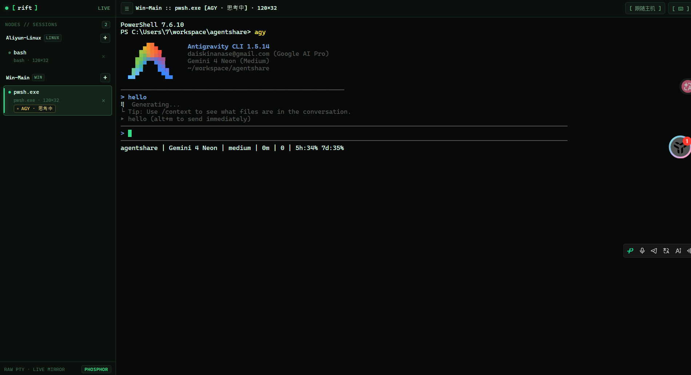

# Rift

<p align="center">
  <a href="./README.md">简体中文</a> · <strong>English</strong>
</p>

<p align="center">
  <strong>Open a razor-thin rift into your local terminals — mirror any native shell on Windows, Linux, or macOS to any browser in real time.</strong>
</p>

<p align="center">
  
</p>

---

## What is Rift?

If you run terminal-native AI coding agents (`Claude Code`, `Codex`, `Antigravity / agy`) or long-running dev shells on your local machines and want to check on them or send a quick command from your phone or another laptop:

- **Remote Desktop (RDP / VNC / RustDesk)** streams heavy video pixels, is painful on mobile screens, and breaks when windows are covered or minimized.
- **Heavy AI Workbenches** impose custom Git worktrees, task databases, multiplexer borders, and keybindings that replace your native terminal workflow.

**Rift stays intentionally minimal:**
1. **Zero-friction native experience**: A single ~1.5 MB Rust binary (`rift`) with zero runtime dependencies. It wraps your real OS PTY (Windows ConPTY / Unix PTY) transparently in raw mode — no status bars, no keybinding hijacking, works with Windows Terminal, PowerShell, CMD, Ghostty, Alacritty, Bash, or Zsh.
2. **Multi-host aggregation**: Connect your Windows desktop, work laptop, and Linux servers to one lightweight self-hosted Relay server and switch between all hosts and tabs from a single web UI.
3. **True bidirectional mirror + local attach**: Terminals opened locally mirror live to the browser; sessions spawned remotely with **`+`** can be joined seamlessly from your local terminal via `rift attach` (`Ctrl+]` to detach without killing the background process).
4. **Minimal active AI agent status**: When `agy` or `Claude Code` is detected during `rift setup`, Rift installs lightweight read-only lifecycle hooks that surface **`Running` / `Tool` / `Waiting` / `Idle`** badges right in the sidebar — without touching your permission policy or adding heavy orchestration.

---

## Architecture

```text
  Host A1 (Windows: WT / PowerShell / CMD)      Host A2 (Linux: Server / Ghostty / Bash)
   ├── rift.exe (~1.5 MB Rust binary)            ├── rift (~1.8 MB Rust binary)
   └── rift daemon (autostart, always-online)    └── rift daemon (systemd, <1 MB RAM)
                        │                                          │
                        └────────────────────┬─────────────────────┘
                                             ▼  (WSS reverse dial + 256 KB RingBuffer auto-reconnect)
                        Relay C (@rift/relay — pure in-memory Node HTTP/WS, no DB)
                         └── Serves static web UI (@rift/web · xterm.js · EMBER / PHOSPHOR themes)
                                             │
                                             ▼
                        Browser B (Phone 4G/5G / Tablet / Laptop)
                         ├── Multi-host sidebar + remote `+` spawn / `×` close
                         ├── "Follow Host" mode (never squishes desktop layout) / "Fit Local" toggle
                         └── Mobile tactile keycap bar (Esc / Tab / ^C / Arrows) + IME-friendly composer
```

---

## Repository Layout

| Path | Stack | Description |
| :--- | :--- | :--- |
| ─── | ─── | ─── |
| [crates/rift](./crates/rift) | **Rust** (`portable-pty`, `tokio-tungstenite`, `crossterm`) | Single-binary cross-platform client (`rift`, `setup`, `uninstall`, `daemon`, `attach`, `agent-hook`) |
| ─── | ─── | ─── |
| [packages/shared](./packages/shared) | TypeScript | Binary PTY frame codec, JSON control protocol & `ByteRingBuffer` |
| ─── | ─── | ─── |
| [packages/relay](./packages/relay) | TypeScript + Node.js (`http`, `ws`) | Stateless in-memory multi-host WS router with `AGENT_SECRET` & `WEB_TOKEN` auth |
| ─── | ─── | ─── |
| [packages/web](./packages/web) | TypeScript + Vite + `@xterm/xterm` | Minimal dual-theme (`EMBER` / `PHOSPHOR`) terminal web client |
| ─── | ─── | ─── |
| [packages/agent](./packages/agent) | TypeScript + `node-pty` | Reference Node.js client (100% wire-compatible with the Rust binary) |

---

## Quick Start

### 1. Run the Relay Server (`@rift/relay` + `@rift/web`)

```bash
npm install
npm run build

# Set WEB_TOKEN & AGENT_SECRET for public deployments behind HTTPS (e.g., Nginx)
WEB_TOKEN=your-web-token PORT=7700 npm run relay
```

Open `http://127.0.0.1:7700/` (or your HTTPS reverse-proxy URL).

### 2. Build the Rust Single-Binary Client

```bash
cargo build --release --manifest-path crates/rift/Cargo.toml
```

Artifacts:
- Windows: `crates/rift/target/release/rift.exe` (~1.5 MB)
- Linux / macOS: `crates/rift/target/release/rift` (~1.8 MB)

### 3. One-Command Setup (Windows & Linux)

Only `--relay` is required; everything else uses sensible OS defaults:

```bash
# Windows (installs to ~/.rift/bin, hooks PS7/PS5.1/CMD/Git Bash & agy/claude, enables autostart daemon)
rift setup --relay https://your-relay-domain.com --token your-web-token

# Linux server (installs to PATH, enables systemd rift-daemon; keeps SSH untouched)
rift setup --relay https://your-relay-domain.com --token your-web-token

# Linux desktop (e.g., Ghostty / Alacritty — pass --with-hook to auto-mirror local shells)
rift setup --relay https://your-relay-domain.com --token your-web-token --with-hook
```

### 4. Daily Commands & Clean Uninstall

```bash
rift                 # Manually wrap default shell (automatic once hooked via setup)
rift -- cmd.exe      # Wrap any specific shell or CLI
rift daemon          # Keep host online with 0 open sessions so remote `+` always works
rift attach          # Attach local terminal to a remote-spawned session (Ctrl+] to detach)
rift uninstall       # Cleanly stop daemon, remove autostart & strip all shell/AI hooks (--purge removes binary, ~/.rift & PATH)
```

> Set `RIFT_DISABLE=1` to temporarily bypass auto-mirroring in any shell.

---

## End-to-End Tests

```bash
npm run build
cargo build --release --manifest-path crates/rift/Cargo.toml
npm run test:e2e
npm run test:win-keys   # Windows: nested ConPTY key contract
```

> Full local gate (identical to CI): `npm run check`; quick tier without cargo: `npm run check:quick`.

---

## License

[MIT](./LICENSE)
