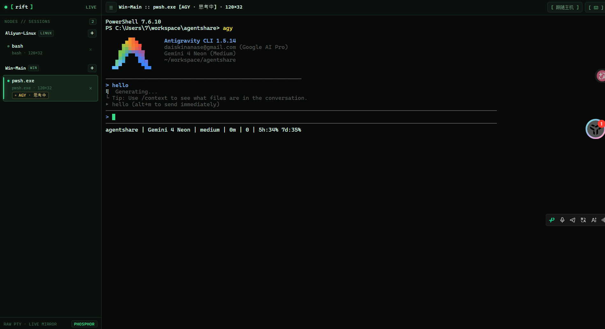

# Rift

<p align="center">
  <strong>简体中文</strong> · <a href="./README.en.md">English</a>
</p>

<p align="center">
  <strong>撕开一道极薄的终端空间裂隙——把你本地开着的任意原生终端直接映射到网页，随时随地用手机或另一台电脑实时双向同屏操控。</strong>
</p>

<p align="center">
  
</p>

---

## 这是干嘛的？

现在大家都在本地电脑上跑 `Claude Code`、`Codex`、`Antigravity (agy)` 这类命令行 AI 工具，或者开着一堆本地 PowerShell / Linux 终端。当你离开工位、换台电脑、或者出门只带手机，想看一眼任务跑完了没、顺手补一句指令时：

- **远程桌面（向日葵 / ToDesk / RDP）**：视频流带宽大、手机小屏极难操作、窗口不能遮挡；
- **重型 AI 工作台**：动辄接管 Git Worktree、任务库、复用器边框和快捷键，太重且改变原本使用习惯。

**Rift 只做最薄、最克制的一件事**：
1. **本地 100% 原生无感**：Rust 单文件客户端（仅 ~1.5 MB，零 Node.js 运行依赖），透传本机原生 PTY（Windows ConPTY / Linux & macOS Unix PTY），无边框、无复用器劫持，不改变你在 Windows Terminal / PowerShell / CMD / Ghostty / Bash 里的任何使用习惯。
2. **多台主机汇聚到一个网页**：家里 Windows 主力机、公司电脑、云上 Linux 服务器全部反向连到你自己的轻量中转服务（Relay），一个网页左侧栏一键切换所有主机和终端标签。
3. **双向同屏 + 随时钻入**：本地开终端 → 手机/网页实时同屏接管；手机点 **`+`** 远程新开终端 → 回到电脑敲一行 `rift attach` 原地钻入（`Ctrl+]` 脱离，后台继续运行）。
4. **极简 AI Agent 主动状态提示**：检测到本机装了 `agy` 或 `Claude Code` 时，自动注入极轻的纯只读汇报钩子，网页侧边栏实时显示 **`思考中` / `执行工具` / `待确认` / `空闲`** 状态徽章，不做任何多余编排，也不干涉原有权限策略。

---

## 架构一览

```text
  主机 A1（Windows: WT / PowerShell / CMD）      主机 A2（Linux: 服务器 / Ghostty / Bash）
   ├── rift.exe（1.5MB Rust 单文件透明代理）       ├── rift（1.8MB Rust 单文件）
   └── rift daemon（开机常驻，0 会话也可点 +）      └── rift daemon（systemd 常驻，<1MB 内存）
                        │                                          │
                        └────────────────────┬─────────────────────┘
                                             ▼  (WSS 反向连接 + 256KB RingBuffer 断线自动重连)
                        中转网关 C（@rift/relay，纯内存 Node HTTP/WS，无数据库）
                         └── 静态托管极简前端（@rift/web · xterm.js · EMBER / PHOSPHOR 双主题）
                                             │
                                             ▼
                        任意浏览器 B（手机 4G/5G / 平板 / 另一台电脑）
                         ├── 左侧多机分组与标签切换 + 远程 `+` 新建 / `×` 关闭
                         ├── 「跟随主机」防挤乱模式（默认不修改电脑列宽） / 「适配本机」一键切换
                         └── 手机端实体键帽快捷栏（Esc / Tab / ^C / 方向键）+ 中文独立发送框
```

---

## 仓库结构

| 目录 | 语言 / 技术栈 | 说明 |
| :--- | :--- | :--- |
| ─── | ─── | ─── |
| [crates/rift](./crates/rift) | **Rust** (`portable-pty`, `tokio-tungstenite`, `crossterm`) | 跨平台单文件客户端 `rift`（透明代理、`setup`、`uninstall`、`daemon`、`attach`、`agent-hook`） |
| ─── | ─── | ─── |
| [packages/shared](./packages/shared) | TypeScript | 二进制 PTY 帧编解码协议、JSON 控制消息类型与 `ByteRingBuffer` |
| ─── | ─── | ─── |
| [packages/relay](./packages/relay) | TypeScript + Node.js (`http`, `ws`) | 极简纯内存多机中转服务端（支持 `AGENT_SECRET` / `WEB_TOKEN` 双鉴权与静态托管前端） |
| ─── | ─── | ─── |
| [packages/web](./packages/web) | TypeScript + Vite + `@xterm/xterm` | 极简双栏 Web 终端界面（内置 `EMBER` 余烬暖炭 / `PHOSPHOR` 磷光黑客绿双主题） |
| ─── | ─── | ─── |
| [packages/agent](./packages/agent) | TypeScript + `node-pty` | Node.js 版参考客户端（与 Rust 版协议 100% 互通） |

---

## 快速开始

### 1. 启动中转服务 C（`@rift/relay` + `@rift/web`）

```bash
npm install
npm run build

# 启动中转（公网部署强烈建议设置 WEB_TOKEN 与 AGENT_SECRET，并前置 Nginx HTTPS）
WEB_TOKEN=your-web-token PORT=7700 npm run relay
```

浏览器打开 `http://127.0.0.1:7700/`（或你的 HTTPS 反代域名）。

### 2. 编译 Rust 单文件客户端 `rift`

```bash
cargo build --release --manifest-path crates/rift/Cargo.toml
```

编译产物位于：
- Windows：`crates/rift/target/release/rift.exe`（~1.5 MB）
- Linux / macOS：`crates/rift/target/release/rift`（~1.8 MB）

### 3. 一条命令完成本机配置（Windows & Linux 通用）

只需传入你的中转服务器地址（其余全走智能默认）：

```bash
# Windows（默认安装到 ~/.rift/bin + 绑定 PS7/PS5.1/CMD/Git Bash + 注入 agy/claude 状态钩子 + 开机自启 daemon）
rift setup --relay https://your-relay-domain.com --token your-web-token

# Linux 服务器（默认安装到 PATH + 启用 systemd rift-daemon 服务，不干扰日常 SSH）
rift setup --relay https://your-relay-domain.com --token your-web-token

# Linux 桌面机（如 Ghostty / Alacritty，需要本地开窗口自动上网页时加上 --with-hook）
rift setup --relay https://your-relay-domain.com --token your-web-token --with-hook
```

### 4. 常用命令与一键卸载

```bash
rift                 # 手动以透明代理启动默认 Shell（setup 绑定后日常无需手敲）
rift -- cmd.exe      # 指定启动任意 Shell 或 CLI
rift daemon          # 常驻保活主机在线（0 会话时手机也可随时点 + 远程新建）
rift attach          # 本地终端接管远程点 + 出来的后台会话（按 Ctrl+] 脱离不杀进程）
rift uninstall       # 一键停止守护、移除开机自启与所有 Shell / AI 钩子（加 --purge 同时清配置）
```

> 临时想开一个不上云的纯本地窗口：设置环境变量 `RIFT_DISABLE=1` 即可跳过自动接入。

---

## 端到端测试

```bash
npm run build
cargo build --release --manifest-path crates/rift/Cargo.toml
npm run test:e2e
```

---

## 环境变量速查

| 变量 | 适用端 | 说明 | 默认值 |
| :--- | :--- | :--- | :--- |
| ─── | ─── | ─── | ─── |
| `PORT` / `HOST` | Relay | 监听端口与地址 | `7700` / `0.0.0.0` |
| ─── | ─── | ─── | ─── |
| `WEB_TOKEN` | Relay / CLI | 浏览器与 `rift attach` 访问密钥（留空则免登录） | 空 |
| ─── | ─── | ─── | ─── |
| `AGENT_SECRET` | Relay / CLI | 主机 Agent 注册共享密钥（留空则不校验） | 空 |
| ─── | ─── | ─── | ─── |
| `RIFT_RELAY` / `RIFT_HOST` | CLI | 覆盖 `~/.rift/config.json` 中的中转地址与主机名 | 配置文件值 |
| ─── | ─── | ─── | ─── |
| `RIFT_DISABLE` | CLI Hook | 设为 `1` 时临时跳过自动捆绑钩子 | 未设置 |

---

## License

[MIT](./LICENSE)
